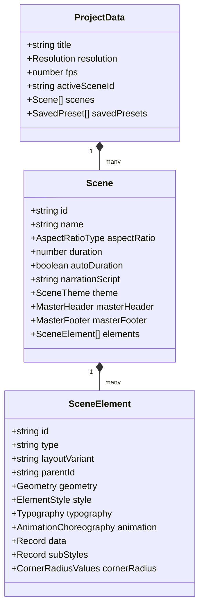

# Visual Storyboard & Scene Spec Studio (VSSS)
## System Architecture & Technical Reference

---

## 1. Executive Summary & Purpose

**Visual Storyboard & Scene Spec Studio (VSSS)** is a browser-based, high-precision visual storyboarding, scene staging, and animation specification IDE. It is designed specifically for technical and educational video creators (with first-class support for both Bengali and English typography).

### Core Capabilities:
- **Interactive Staging Canvas**: Multi-aspect ratio viewport (`16:9` Full HD 1920×1080, `9:16` Vertical 1080×1920 for Shorts/Reels/TikTok, and `1:1` Square 1080×1080) with Title Safe Area guides and pixel-grid snapping.
- **Dual-Tier Component System**:
  - **Tier 1 (Smart Components)**: 7 pre-engineered domain components (logic gates, truth tables, code runners, dynamic lists, concept cards, callouts, hero headers), each offering **4–5 structural layout variants (`layoutVariant`)** and **per-part sub-styling (`subStyles`)**.
  - **Tier 2 (Atomic & Layout Containers)**: Flexbox and Grid auto-layout containers (`container_box`) with nested child management, plus primitive building blocks (`basic_text`, `basic_badge`, `basic_divider`).
- **Elementor-Grade 3-Tab Inspector**: Granular control over Content, Style (including 4-corner independent border radii and sub-part styling), and Advanced properties (4-way linked/unlinked padding and margin box models, voiceover timing, canvas alignments).
- **Dual Animation Engine Export**: Generates pixel-accurate 1920×1080 PNG graphics and automated code blueprints for both **Remotion (React / TypeScript)** and **Manim (Python)**.

---

## 2. Directory & File Architecture

```
rex_storyboard/
├── index.html                   # HTML entry point with web font imports (Kalpurush, Hind Siliguri, JetBrains Mono, Inter)
├── package.json                 # Dependencies (React 19, Vite 8, Zustand, Immer, Lucide, Tailwind 4)
├── tsconfig.json                # TypeScript compiler configuration (strict mode, path alias '@/*')
├── vite.config.ts               # Vite bundler configuration with Tailwind & React plugins
├── ARCHITECTURE.md              # System architecture reference (this document)
└── src/
    ├── App.tsx                  # Root layout: 52px TopToolbar + 3-column workspace + 120px BottomBar + Modals
    ├── index.css                # Global Tailwind directives and custom scrollbar styles
    ├── main.tsx                 # React DOM mount point
    │
    ├── types/
    │   └── studio.ts            # Canonical domain types, geometries, animation specs, scene graphs
    │
    ├── store/
    │   └── studioStore.ts       # Central Zustand + Immer store, debounced IndexedDB sync, history stack (undo/redo)
    │
    ├── registry/
    │   ├── types.ts             # Registry type contracts (ComponentDefinition, LayoutVariantDef)
    │   ├── styleUtils.ts        # Shared styling constants, resolveElementStyles, getFontFamilyCss, toBanglaDigit
    │   ├── componentDefaults.ts # Decoupled component default models & variant definitions (zero UI dependencies)
    │   ├── componentRegistry.tsx # Slim registry aggregator (<70 lines) and public lookup APIs
    │   └── components/          # Modular component implementations
    │       ├── smart/           # Smart domain components (HeroText, ConceptCard, DynamicList, CodeRunner, LogicGate, TruthTable, CalloutPointer)
    │       ├── containers/      # Layout containers (ContainerBox)
    │       └── atomic/          # Primitive widgets (BasicText, BasicBadge, BasicDivider)
    │
    ├── components/
    │   ├── TopToolbar.tsx       # Top bar: project title, aspect ratio switch, safeguard, zoom, export actions
    │   ├── LeftSidebar.tsx      # Left panel: Smart Components, Atomic Widgets, Saved Presets, Templates
    │   ├── CanvasViewport.tsx   # Center viewport: Rnd drag/resize, safe guides, master chrome, grid overlay
    │   ├── ElementErrorBoundary.tsx # Error boundary protecting canvas and containers from malformed elements
    │   ├── RightSidebar.tsx     # Right inspector: Tab host (Content, Style, Advanced) and Live Dual AI Spec viewer
    │   ├── inspector/
    │   │   ├── ContentTab.tsx   # Elementor Tab 1: Layout variant switcher, custom data inspector, child detaching
    │   │   ├── StyleTab.tsx     # Elementor Tab 2: Theme presets, sub-part targeting, 4-corner radius, typography
    │   │   └── AdvancedTab.tsx  # Elementor Tab 3: 4-way box model, motion choreography, voiceover sync, container nesting
    │   ├── BottomBar.tsx        # Bottom strip: Scene selector, narration editor, voiceover timeline sync
    │   └── FullSpecModal.tsx    # Modal for full multi-scene spec preview and JSON import/export
    │
    └── utils/
        ├── hardwareSvgPresets.ts# Built-in SVG schematics (AND, OR, NOT, NAND, NOR, XOR, Arduino, 555 Timer)
        ├── themePalettes.ts     # Dark/light theme presets & dynamic background luminance calculator
        ├── voiceSync.ts         # Bengali/English word pacing and voiceover timestamp cue generator
        └── specGenerator.ts     # Markdown, Remotion TSX, and Manim Python specification compiler
```

---

## 3. Data Models & Type Hierarchy (`src/types/studio.ts`)

### A. Scene Graph Structure


### B. Extended Geometry & Elementor Box Model
```typescript
export interface ElementStyle {
  bgMode: 'solid' | 'gradient' | 'transparent';
  bgColor: string;
  gradientColor2?: string;
  gradientAngle?: number;
  bgOpacity: number;
  backdropBlur: number;
  borderWidth: number;
  borderWidths?: BoxModelValues; // 4-way individual linked/unlinked border thicknesses
  borderStyle: 'solid' | 'dashed' | 'dotted' | 'none';
  borderColor: string;
  borderRadius: number;
  padding: number;
  glowColor: string;
  glowIntensity: number;
}

export interface CornerRadiusValues {
  topLeft: number;
  topRight: number;
  bottomRight: number;
  bottomLeft: number;
  linked: boolean; // When true, all 4 corners update synchronously
}

export interface Geometry {
  x: number;
  y: number;
  width: number;
  height: number;
  zIndex: number;
  rotation?: number;
  autoHeight?: boolean;
  paddingBox?: BoxModelValues; // 4-way internal padding
  marginBox?: BoxModelValues;  // 4-way external margin
}
```

### C. Granular Sub-Part Styling
Elements are broken down into targetable sub-parts:
```typescript
export type SubPartTarget = 
  | 'container'  // Root card container
  | 'badge'      // Status pill / tag
  | 'title'      // Main heading
  | 'body'       // Subtitle / explanatory text
  | 'items'      // List items, table cells, or bento nodes
  | 'accent';    // Highlights, icons, or accent lines

export interface SubPartStyle {
  typography?: Partial<Typography>;
  bgColor?: string;
  bgOpacity?: number;
  textColor?: string;
  borderColor?: string;
  borderWidth?: number;
  borderRadius?: number;
  glowColor?: string;
  glowIntensity?: number;
}
```

---

## 4. Dual-Tier Component System (`src/registry/componentRegistry.tsx`)

### Tier 1: Smart Components (`tier: 'smart'`)
Each component is designed for 90% of workflow velocity, packaging complete visual hierarchy with multiple structural variants:

| Component Type | Label | Variants Count | Structural Variants (`layoutVariant`) | Available Sub-Parts |
|---|---|---|---|---|
| `hero_text` | Hero Header Block | 5 | `standard_stack`, `numbered_chapter`, `kinetic_word_box`, `terminal_banner`, `editorial_quote` | container, badge, title, body, accent |
| `concept_card` | Smart Concept & KPI Card | 5 | `blueprint_header_card`, `glass_card`, `horizontal_icon_card`, `kpi_metric_stat`, `warning_callout` | container, badge, title, body, accent |
| `dynamic_list` | Smart List & Timeline | 5 | `bento_card_pills`, `vertical_timeline`, `horizontal_roadmap`, `two_col_grid`, `compact_checklist` | container, title, items, accent |
| `code_formula` | Code & Equation Window | 4 | `macos_terminal`, `vscode_tab`, `split_code_output`, `math_formula_box` | container, title, body, accent |
| `svg_diagram` | Hardware & Schematic | 3 | `clean_frame`, `labeled_blueprint`, `pinout_card` | container, accent |
| `truth_table` | Dynamic Matrix & Table | 3 | `cyber_grid`, `striped_datasheet`, `highlighted_output_col` | container, title, items, accent |
| `callout_pointer` | Callout Pointer & Badge | 3 | `arrow_badge`, `pulsing_pin_label`, `bracket_annotation` | container, title, body, accent |

### Tier 2: Layout Containers & Atomic Widgets (`tier: 'atomic'`)
Used for custom layouts and micro-compositions:
- **`container_box`**: Auto-layout container with 4 layout modes (`flex_row`, `flex_column`, `grid_2col`, `grid_3col`).
- **`basic_text`**: Atomic typography block with Bengali/Latin font selection.
- **`basic_badge`**: Status pill/tag with icon.
- **`basic_divider`**: Glowing technical separator line.

### Nested Layout & Collision Prevention Engine
1. **Top-Level Elements**: In [`CanvasViewport.tsx`](file:///d:/TopicMentor/rex_storyboard/src/components/CanvasViewport.tsx), the artboard filters for `!element.parentId` and wraps each top-level element in a `react-rnd` component for free dragging, resizing, and snapping.
2. **Nested Elements**: When an element has `parentId === containerId`, it is **excluded from `react-rnd` rendering**. Instead, it renders inside `ContainerBoxRenderer` using CSS Flexbox or CSS Grid flow.
3. **No Coordinate Collisions**: Nested elements flow naturally within their container. They can be reordered up/down or detached back to the canvas at any time.

---

## 5. Elementor-Grade 3-Tab Inspector (`src/components/RightSidebar.tsx`)

The right sidebar provides an Elementor-inspired inspection experience divided into 3 dedicated tabs:

```
┌────────────────────────────────────────────────────────┐
│  [ 📝 Content ]   [ 🎨 Style ]   [ ⚙️ Advanced ]        │
├────────────────────────────────────────────────────────┤
│ TAB 1: CONTENT                                         │
│ • Layout Variant Switcher (visual pills)               │
│ • Component-Specific Form (Titles, Items, Code, SVGs)  │
│ • Container Child Manager (Up/Down order, Detach)      │
├────────────────────────────────────────────────────────┤
│ TAB 2: STYLE                                           │
│ • Sub-Part Target: [Container] [Badge] [Title] [Body]  │
│ • Per-Part Typography: Font, Size, Color, Alignment   │
│ • Per-Part Surface: Solid/Gradient/Transparent, Blur   │
│ • 4-Corner Radius: [TL] [TR] [BR] [BL] (Link toggle)   │
│ • Border & Neon Glow: Width, Color, Glow slider        │
│ • 1-Click Theme Presets                                │
├────────────────────────────────────────────────────────┤
│ TAB 3: ADVANCED                                        │
│ • Elementor Box Model: Padding Box (4-way linked)      │
│ • Elementor Box Model: Margin Box (4-way linked)       │
│ • Geometry: X, Y, Width, Height, Auto-Height ↕         │
│ • Canvas Alignments: Left, Center H, Right, Top, etc.  │
│ • Z-Index Layer Ordering & Parent Container Nesting    │
│ • Animation Choreography & Voiceover Timing (@sec)     │
└────────────────────────────────────────────────────────┘
```

---

## 6. How to Add a New Component (Step-by-Step)

To register a new component into the studio engine, follow these steps:

### Step 1: Define Layout Variants & Default Data
In [`src/registry/componentRegistry.tsx`](file:///d:/TopicMentor/rex_storyboard/src/registry/componentRegistry.tsx):
```typescript
const MY_COMPONENT_VARIANTS: LayoutVariantDef[] = [
  { id: 'standard', label: 'Standard Card', description: 'Clean layout' },
  { id: 'compact', label: 'Compact Row', description: 'Horizontal layout' }
];
```

### Step 2: Create Component Module in `src/registry/components/`
Create `src/registry/components/smart/MyComponent.tsx` containing its isolated Canvas renderer, Content inspector, and definition:
```tsx
import React from 'react';
import { Sparkles } from 'lucide-react';
import { SceneElement } from '../../../types/studio';
import { ComponentDefinition } from '../../types';
import { COMPONENT_DEFAULTS } from '../../componentDefaults';
import { resolveElementStyles, getSubPartStyle } from '../../styleUtils';

export const MyComponentRenderer: React.FC<{ element: SceneElement; isSelected: boolean }> = ({ element }) => {
  const containerStyle = resolveElementStyles(element);
  const titleSub = getSubPartStyle(element, 'title');
  const titleColor = titleSub.textColor || element.typography.textColor;

  return (
    <div style={containerStyle}>
      <h3 style={{ color: titleColor }}>{element.data.title || 'Default Title'}</h3>
    </div>
  );
};

export const MyComponentInspector: React.FC<{
  element: SceneElement;
  onChange: (newData: Record<string, any>) => void;
}> = ({ element, onChange }) => {
  return (
    <div>
      <label className="text-xs text-slate-400">Card Title</label>
      <input
        type="text"
        value={element.data.title || ''}
        onChange={(e) => onChange({ title: e.target.value })}
        className="w-full bg-slate-950 border border-slate-800 rounded p-1 text-slate-200"
      />
    </div>
  );
};

export const myComponentDef: ComponentDefinition = {
  ...COMPONENT_DEFAULTS.my_component,
  type: 'my_component',
  label: 'My New Component',
  category: 'Data & Logic',
  tier: 'smart',
  icon: Sparkles,
  CanvasRenderer: MyComponentRenderer,
  DataInspector: MyComponentInspector,
  specFormatter: (el) => `- **My Component**: "${el.data.title || ''}"`
};
```

### Step 3: Register in `COMPONENT_REGISTRY`
Import and add `myComponentDef` into `COMPONENT_REGISTRY` in [`src/registry/componentRegistry.tsx`](file:///d:/TopicMentor/rex_storyboard/src/registry/componentRegistry.tsx):
```typescript
import { myComponentDef } from './components/smart/MyComponent';

export const COMPONENT_REGISTRY: Record<string, ComponentDefinition> = {
  // ...
  my_component: myComponentDef
};
```

The component is immediately available in the Left Sidebar, Canvas, and Right Inspector.

---

## 7. How to Add a New `layoutVariant` Skin

To add a new structural layout variation to an existing component:

1. **Add the variant definition** to the component's variant array in [`componentRegistry.tsx`](file:///d:/TopicMentor/rex_storyboard/src/registry/componentRegistry.tsx):
   ```typescript
   { id: 'new_skin_name', label: 'New Skin Name', description: 'Description of layout' }
   ```
2. **Add a conditional branch** in the component's `CanvasRenderer`:
   ```tsx
   if (layoutVariant === 'new_skin_name') {
     return (
       <div style={containerStyle} className="flex flex-row items-center gap-4">
         {/* Alternative HTML / SVG structure */}
       </div>
     );
   }
   ```
3. **Verify** that clicking the new layout pill in the Right Inspector Tab 1 (`📝 Content`) instantly switches the DOM structure.

---

## 8. Export Engine Architecture (`src/utils/specGenerator.ts`)

### Remotion (React / TypeScript) Blueprint
- `container_box` elements map to CSS Flexbox/Grid wrappers (`display: 'flex'` / `display: 'grid'`).
- Top-level elements map to `<AbsoluteFill>` with `<Sequence>` blocks.
- `startAtSecond` locks the start frame: `from={Math.round(startAtSecond * fps)}`.
- Granular sub-styles, 4-corner radii, and padding/margin boxes are mapped to inline styles.

### Manim (Python) Blueprint
- Canvas pixels are converted to Manim 2D camera coordinates centered at `[0, 0, 0]` using `screenToManimCoords()`.
- Containers map to `VGroup().arrange(RIGHT/DOWN, buff=...)`.
- Elements map to `RoundedRectangle` or `Mobject` primitives with `self.wait()` and `self.play(FadeIn/Create/GrowFromCenter)`.

---

## 9. Architectural Guardrails & Invariants

1. **Strict Canvas Boundary Containment**: Elements can never be positioned outside artboard coordinates. Bound limits are enforced in `updateElementGeometry` and `CanvasViewport.tsx`.
2. **Aspect Ratio Non-Destruction**: When toggling between `16:9`, `9:16`, and `1:1`, geometries for the previous ratio are cached in `scene.aspectRatioLayouts`. Switching back restores original coordinates with 100% fidelity.
3. **Collision-Free Nesting**: An element with `parentId` must never be rendered inside an `Rnd` wrapper. Nesting is purely managed by CSS Flex/Grid inside `container_box`.
4. **State Immutability & Undo/Redo**: All state mutations in [`studioStore.ts`](file:///d:/TopicMentor/rex_storyboard/src/store/studioStore.ts) go through Immer. Deep snapshots are stored in the history stack and persisted to browser IndexedDB via `idb-keyval`.
5. **Decoupled Default Factory**: Never import `componentRegistry.tsx` into `studioStore.ts`. Default element models, variant lists, and styling presets must be imported from `componentDefaults.ts` and `styleUtils.ts` to prevent circular dependency cycles.
6. **Debounced Persistence**: All IndexedDB writes through `idb-keyval` are debounced (400ms delay) to ensure continuous slider dragging and real-time inspector updates never block the main thread or flood storage I/O.
7. **Element Error Isolation**: Canvas elements and nested container items must be wrapped in `<ElementErrorBoundary>`. If an invalid user SVG or corrupt data structure causes a React render crash, only the offending element displays a localized fallback with a Retry action, keeping the studio canvas fully interactive.
8. **Preserve Documentation & Types**: When modifying components or store actions, always ensure `npm run lint` (`tsc --noEmit`) and `npm run build` pass with zero errors.

